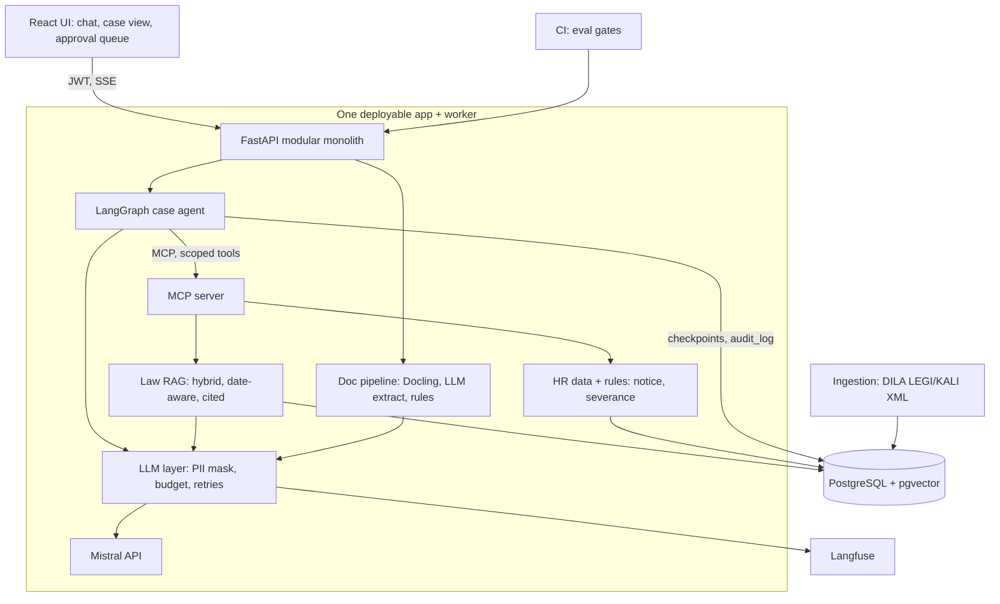

# LexRH — HR Case Copilot for French SMEs
### Capstone specification for a French AI Engineer PFE (2027)

*Prepared 5 November 2026. Based on a review of 16 French internship offers for 2026–2027 starts (links in section 1).*

**20-second pitch:** *"LexRH answers French labour-law questions with verifiable, date-aware citations. It can also run a whole HR case, such as a dismissal, through an agent that reads uploaded documents and calls business tools. It never acts without human approval, and it never sends personal data to the LLM."*

---

## 1. Why this project (market evidence)

16 offers were read (Welcome to the Jungle, Welcome Kit, JobTeaser, aggregators). Counts are directional, not statistical.

| Skill / technology | Rough frequency | Verdict |
|---|---|---|
| Python, production quality | 16/16 | Essential |
| RAG (ingestion, chunking, embeddings, retrieval, reranking) | ~9/16 | Essential |
| Agents, tool calling, orchestration | ~8/16 | Essential for AI Engineer roles |
| LLM evaluation (eval sets, cost, robustness) | ~7/16 | Essential, the biggest differentiator |
| APIs + tests + Docker + CI/CD named explicitly | ~6/16 | Essential at PFE level |
| LangChain / LangGraph | ~6/16 | Learn LangGraph |
| SQL / PostgreSQL | ~5/16 | Essential |
| Observability | ~5/16 | Essential for production-minded offers |
| MCP | 3/16 (BNP, RCA1, OVHcloud) | Rising, worth building once |
| TypeScript / React | ~4/16 | Thin frontend is enough |
| Kubernetes | 1/16 | Ignore for now |
| Fine-tuning / training | 1–2/16 | Ignore for now |
| Dedicated vector DB | alternatives only (EY lists pgvector first) | pgvector is enough |

**Offers that shaped the design**

| Offer | Link | What it asks for |
|---|---|---|
| Health Data Hub, RAG optimisation | https://www.welcometothejungle.com/fr/companies/plateforme-des-donnees-de-sante/jobs/stage-6-mois-ai-ml-engineer-optimisation-rag-donnees-de-sante-snds_paris | Chunking, metadata, embeddings, reranking; quality/latency/cost trade-offs; sourced answers |
| EY Consulting, AI Engineer | https://www.welcometothejungle.com/fr/companies/ey/jobs/stage-de-fin-d-etudes-ai-engineer-f-h_paris | RAG pipelines, FastAPI, pgvector, tests, evaluation, monitoring, Docker, CI/CD |
| Galadrim, AI Engineer | https://galadrim.welcomekit.co/jobs/ingenieur-ia-stage-de-fin-d-etudes_paris | RAG, agents, eval sets, CI/CD; document pipeline with OCR, LLM structuring, rules engine and human validation |
| BNP Paribas ALMT (closed 31 Oct 2026) | https://freehire.me/jobs/stage-data-scientist-almt-digital-innovations-ai-h-f-bnp-paribas-c5aq76ut | Agents over documents, databases, tools, APIs and internal MCP; LangGraph |
| RCA1, agentic AI | https://zapply.jobs/jobs/c67dbee5-b4c7-423c-82f6-7561b605b6a5/ | Business functions as MCP tools with proper rights management; reliability, cost, observability, data sovereignty; FastAPI, Docker, CI |
| Polynom, AI Engineer | https://freehire.me/jobs/stage-ai-engineer-polynom-koklkenl | LangGraph, tests, CI/CD, observability; an end-to-end project is "un vrai plus" |
| Oguste, AI Engineer | https://jobpilot.suxrobgm.net/jobs/ai-engineer-stage-janvier-2027-at-oguste-3586a5 | Clean tested production code; reliable document extraction |
| OVHcloud (partial text) | https://www.jobijoba.com/fr/emploi/OVH/Roubaix | MCP skills; evaluating and hardening agents on cost and security |

Several of these were read through aggregator mirrors, and some are closing soon (Health Data Hub listing valid to 30 Dec 2026, Galadrim to 19 Jan 2027). Check the originals before applying.

**Why one merged project.** Each layer below mirrors a pattern that recurs in the offers, and they share one database and one deployment. That makes it a single story to explain.

---

## 2. Product

### 2.1 Business problem
SME HR managers, payroll staff and accounting firms answer recurring questions every day (notice periods, overtime, leave, trial periods, dismissal procedures). The answer depends on the Code du travail **and** the company's collective agreement (IDCC), and it must be correct **for a given date**, because both change over time. Errors create legal and financial risk.

### 2.2 Users
- HR generalists in SMEs without in-house lawyers.
- Payroll staff.
- Accountants managing several client companies with different IDCCs.

### 2.3 Four layers

| Layer | Function |
|---|---|
| **1. Knowledge (RAG)** | Hybrid retrieval over Code du travail and collective agreements, filtered by IDCC and "as of" date, with verified citations and refusal when evidence is weak. |
| **2. Documents** | Upload a contract or payslip. Docling parses it, an LLM extracts fields into a schema, rules validate it, and a human corrects it in a review screen. |
| **3. Case agent** | LangGraph agent handles a case (for example "terminate employee X"). It calls MCP tools and pauses for human approval before any action. |
| **4. Trust layer** | PII masking before every LLM call, per-tenant budgets, Langfuse tracing, audit log, CI evaluation gates. |

### 2.4 MVP vs advanced

| MVP (end of week 4, deployed) | Advanced (weeks 5–8) |
|---|---|
| Code du travail only | 3–5 collective agreements (KALI) |
| Date-aware hybrid retrieval, cited answers, refusal | Reranker, query rewriting, caching |
| Auth, golden set, CI evaluation report | Case agent with MCP and approval flow |
| Live URL | Document extraction and review screen, PII masking, budgets |

---

## 3. Technical architecture



### 3.1 Component responsibilities

| Component | Responsibility |
|---|---|
| Ingestion worker | Downloads LEGI/KALI XML (or calls the Légifrance API on PISTE), parses articles with ID, status, validity dates, IDCC. Chunks per article, embeds, upserts. Nightly run, only re-embeds when the content hash changes. |
| Query service (FastAPI) | Auth, query rewrite, hybrid retrieval (pgvector + full-text, filtered by IDCC and date), rank fusion, optional rerank, structured generation, citation verifier, SSE streaming. |
| Document pipeline | Docling layout parsing and OCR, LLM extraction into a Pydantic schema with confidence and source location, deterministic rules, routing to review. |
| MCP server | Exposes typed, permission-scoped tools to the agent (section 6). |
| Case agent (LangGraph) | State machine: classify, gather, assess, compute, interrupt for approval, execute, close. Postgres checkpoints. Step limit. |
| LLM layer | One internal module: PII masking, budget check, timeouts, retries with backoff, provider interface (Mistral behind an OpenAI-compatible abstraction). |
| Frontend (React + TS) | Chat with citations and date picker, case view with trace, document review, approval queue. |
| Observability | Langfuse traces for retrieval, tools and LLM calls, with cost and latency. |

### 3.2 Data flows

1. **Question:** UI → `/ask` (JWT) → rewrite → hybrid retrieval (IDCC + date filter) → fusion/rerank → masked prompt → structured answer → citation verifier (retry once, otherwise refuse) → SSE to UI → trace to Langfuse.
2. **Document:** upload → object stored → job queued → Docling → LLM extraction → rules → auto-accept or review queue → human corrects → employee/contract record updated.
3. **Case:** user opens a case → agent loop calls MCP tools → deterministic computation → **interrupt** → handler approves, edits or rejects → agent drafts the letter → audit log entry.

### 3.3 Frontend/backend communication
REST + JSON for CRUD, SSE for streaming answers and agent progress, JWT bearer tokens, one OpenAPI schema from which TypeScript types are generated.

---

## 4. Database design (PostgreSQL)

| Table | Key columns |
|---|---|
| `tenants`, `users` | `users(id, tenant_id, email, password_hash, role)` with roles `admin`, `hr`, `viewer` |
| `company_profiles` | `id, tenant_id, idcc, name, headcount` |
| `documents` (legal corpus) | `id, source[LEGI\|KALI], legal_id, title, idcc, valid_from, valid_to, status, content_hash` |
| `chunks` | `id, document_id, ord, text, embedding vector, tsv tsvector, metadata jsonb`. HNSW on `embedding`, GIN on `tsv`, B-tree on `(idcc, valid_from, valid_to)` |
| `employees` | `id, tenant_id, name_enc, hire_date, contract_type, salary, idcc` (synthetic data only) |
| `uploads` | `id, tenant_id, storage_key, sha256, status, doc_type` |
| `extractions`, `field_values` | `payload jsonb, schema_version, cost_eur`; `field, value, confidence, page, bbox` |
| `rule_results`, `reviews` | rule name, pass/fail, reviewer corrections |
| `conversations`, `messages`, `citations`, `feedback` | `messages(latency_ms, cost_eur)`; `citations(message_id, chunk_id, rank)` |
| `cases` | `id, tenant_id, employee_id, type, status` |
| `agent_runs`, `approvals` | `graph_state jsonb`; `action, payload jsonb, decided_by, decision, decided_at` |
| `audit_log` | `actor, action, tool, args_hash, result_summary, ts`, append-only (no UPDATE/DELETE grant to the app role) |
| `llm_usage`, `budgets` | tokens, cost, cache flag per call; monthly limit per tenant |
| `eval_runs`, `eval_results` | `git_sha, config jsonb`; per-question metrics |

---

## 5. Technology stack

| Component | Choice | Why | Status |
|---|---|---|---|
| Language | Python 3.12, type hints, Ruff, MyPy | Universal requirement | Essential |
| API | FastAPI + Pydantic v2 | Named by EY and RCA1 | Essential |
| Database | PostgreSQL + pgvector + full-text | One store for relational, vector and keyword search | Essential |
| Migrations | SQLAlchemy 2 + Alembic | Schema evolution | Essential |
| Agent | LangGraph | Named by BNP, RCA1, Polynom, OVHcloud | Essential |
| Tool protocol | MCP (official Python SDK) | Named by BNP, RCA1, OVHcloud | Essential |
| LLM | Mistral API behind an OpenAI-compatible interface | Sovereignty argument, swappable | Essential |
| Document parsing | Docling (MIT, IBM Research) | Local layout + OCR, no API key | Essential |
| Observability | Langfuse (self-hosted, MIT) | Traces, cost, eval scores | Essential |
| Packaging / CI | Docker Compose, GitHub Actions | Requested everywhere | Essential |
| Tests | pytest, testcontainers, Hypothesis | Real Postgres in tests | Essential |
| Frontend | React + TypeScript (Streamlit for the MVP) | Valued by Galadrim, EY, Oguste | Optional |
| Reranker | Cross-encoder from Hugging Face | Health Data Hub names reranking | Advanced |
| Storage | MinIO (or local volume) | Uploaded documents | Optional |
| Queue | Postgres job table | Avoids Redis/Kafka | Essential (simple) |

**Deliberately excluded:** Redis, Kubernetes, Terraform, fine-tuning, LangChain/LlamaIndex, a separate vector database, multi-agent frameworks, forecasting/MLOps. Reasons: rare in the offers, or they add explanation cost without adding to the story.

---

## 6. MCP tools (agent-facing)

| Tool | Scope | Notes |
|---|---|---|
| `search_law(query, idcc, as_of)` | read | Calls the RAG module, returns cited articles |
| `get_employee(employee_id)` | read | Tenant-checked; PII masked in what the LLM sees |
| `get_contract_fields(employee_id)` | read | From validated extractions |
| `compute_notice_and_severance(employee_id, as_of)` | compute | **Deterministic code**, unit-tested, returns a breakdown |
| `draft_letter(case_id, template)` | draft | Creates a draft only |
| `request_missing_documents(case_id, list)` | draft | Creates a draft only |
| `escalate(case_id, reason)` | write | Hands over to a human |

The agent identity is least-privilege: it can read and draft, and it cannot send or finalise anything without an approval token created by a human decision.

---

## 7. AI implementation

### 7.1 RAG
- **Chunking:** one article per chunk, with the hierarchy path (code, book, title, chapter) prepended to the embedded text.
- **Hybrid retrieval:** exact references ("L1234-1") are caught by full-text search and missed by embeddings. Fuse with reciprocal rank fusion.
- **Date awareness:** filter on `valid_from <= as_of < valid_to` and on IDCC.
- **Grounded generation:** Pydantic schema `{answer, citations, confidence}`. The verifier rejects any cited ID that was not retrieved. Retry once, then refuse.
- **Prompt injection:** retrieved text is delimited and treated as data.

### 7.2 Document extraction
The LLM only reads messy layouts into a schema. Validation is deterministic: net + VAT = gross where relevant, date logic, SIREN check digit, salary versus collective-agreement minimum, duplicate detection. Auto-accept only when all rules pass and critical fields exceed a threshold tuned on your own eval set.

### 7.3 Case agent
An agent is justified because the steps depend on the case: contract type, seniority, collective agreement and missing documents. The money decision stays in deterministic code. The LLM proposes, the human decides.
- Tool calling with strict JSON schemas and small focused tools.
- Context engineering: summarised tool results, cited clauses.
- Step limit, per-tool timeouts, idempotency keys on side-effecting tools.

### 7.4 PII masking
Regex for email, phone, IBAN, NIR; NER model for names. Replace with stable placeholders before the LLM call, restore after. Never log clear-text PII.

### 7.5 Where not to use an LLM or agent
FAQ answering is a fixed pipeline, calculations are code, and validation is rules. Be ready to say this in interviews.

---

## 8. Professional engineering

| Topic | What to implement |
|---|---|
| **AuthN/AuthZ** | OAuth2 password flow with short-lived JWT + refresh. Roles `admin`, `hr`, `viewer`. Every query filtered by `tenant_id` through FastAPI dependencies. Agent uses a separate service identity with scoped tools. |
| **Security / data protection** | Secrets in env/Docker secrets. Rate limits per user. Input length limits. CORS allow-list. Signed, time-limited document URLs. Encrypted employee name column. Synthetic data only. 30-day log retention note (GDPR). "Decision support, not legal advice" banner. |
| **Prompt-injection defence** | Delimit untrusted text, validate tool arguments against the domain (employee must belong to the tenant), allow-list recipients, test suite of attack cases. |
| **Error handling** | One error envelope with typed exceptions. Backoff with jitter on LLM 429/5xx. Per-stage timeouts. "Sources only" fallback when the LLM is down. Quarantine and reprocessing for failed documents. |
| **Logging / monitoring** | JSON logs with request IDs. Langfuse traces. `/health` and `/ready`. Track p50/p95 latency and cost per answer. |
| **Testing** | Unit (parser, chunker, fusion, verifier, rules, masking). Integration with real Postgres via testcontainers. API contract tests. Mocked LLM in unit tests. Scripted fake LLM for graph tests. A separate evaluation job. |
| **Docker / deployment** | Multi-stage non-root Dockerfile. Compose services: api, worker, mcp, ui, postgres, langfuse. Small European VPS (OVHcloud or Scaleway; check current prices) behind Caddy or Nginx with TLS. |
| **CI/CD** | lint → type-check → unit/integration tests → evaluation gate → build → push to GHCR → deploy on tag. The build **fails** if recall@5 or citation precision drops beyond a threshold. |
| **Performance / reliability** | HNSW index, embedding cache, answer cache keyed by (normalised question, IDCC, date), async I/O, checkpoint resume for agent runs, load test with Locust or k6. |

---

## 9. Resources (verified in the research unless marked)

| Resource | Details |
|---|---|
| Légifrance data | Free to reuse. Bulk XML (LEGI, KALI and others) at https://echanges.dila.gouv.fr/OPENDATA/. The Légifrance API on PISTE is free after registration, under Licence Ouverte 2.0. Quotas are on the PISTE portal (not verified here). Docs: https://www.legifrance.gouv.fr/contenu/pied-de-page/open-data-et-api |
| Judilibre (court decisions) | Optional extension, available through PISTE |
| Mistral API | A free tier exists, but sources conflict on its current limits. Check your own Limits page and use only public or synthetic data on it. |
| Langfuse | MIT, self-hostable: https://github.com/langfuse/langfuse |
| Docling | MIT, IBM Research, paper at https://arxiv.org/pdf/2501.17887 |
| Reference template | https://github.com/IgnazioDS/langgraph-fastapi-starter (FastAPI, pgvector, auth, Alembic, pytest, CI). Study it, do not fork it. |
| LiteLLM (BerriAI) | Mature open-source LLM gateway. Know that it exists and say that you would evaluate it first in production. |
| Synthetic HR data | Not verified as a public dataset. Generate employees, contracts and payslips yourself with Faker and Jinja templates, rendered to PDF with noisy "scanned" variants. |

---

## 10. Roadmap (8 weeks)

| Week | Milestone | Done when |
|---|---|---|
| 1 | Repo skeleton (uv, Ruff, MyPy, pre-commit), Docker Compose (API, Postgres+pgvector, Langfuse), parse Code du travail | `docker compose up` works, parser tests pass |
| 2 | Article chunking with validity metadata, embeddings, idempotent re-ingestion | Re-running ingestion changes nothing |
| 3 | Hybrid retrieval with RRF and IDCC/date filters. **Golden set** of 100+ questions with expected article IDs | recall@5 measured and committed |
| 4 | Structured generation, citation verifier, refusal, SSE, JWT auth. **Deploy MVP over HTTPS** | Live URL, evaluation report. **Start applying.** |
| 5 | MCP server, HR data and deterministic notice/severance rules, LangGraph agent with approval interrupt | A case runs end to end on synthetic data |
| 6 | Handler UI (trace, approve/edit/reject), audit log, 60+ scenario suite, injection tests | Scenario metrics in CI |
| 7 | Docling extraction and review screen, PII masking, budgets, KALI for 3–5 agreements | Field accuracy and PII recall measured |
| 8 | Reranker, caching, load test, ADRs, README with evaluation report, 3-minute demo video | Everything deployed and documented |

**Cut order if behind:** React review screen (use Streamlit), then reranking, then semantic caching, then KALI beyond 1–2 agreements. **Never cut:** the golden set, the CI gate, the approval flow, the tests.

---

## 11. Evaluation plan

| Layer | Metrics | Source of truth |
|---|---|---|
| Retrieval | recall@k, MRR | Golden article IDs written from real HR FAQs |
| Generation | Citation precision, faithfulness (LLM judge with rubric), refusal accuracy on unanswerable questions | Golden set + adversarial questions |
| Extraction | Field accuracy, straight-through rate, error rate vs. threshold curve | Synthetic ground truth |
| Agent | Routing accuracy, tool-call precision/recall, correct approval stops, steps and cost per run | 60+ scripted scenarios |
| Security | Injection block rate, PII recall | Attack and PII test matrices |
| System | p50/p95 latency, cost per answer | Load test + Langfuse |

Every number on your CV must come from these runs.

---

## 12. Interview preparation

**Likely questions**
- Why hybrid retrieval rather than pure vector search?
- How did you choose chunk size and structure?
- How do you stop hallucinated citations?
- How did you build a golden set without labels?
- Recall@k vs. MRR: when does each mislead?
- How do you handle amended law (date-aware retrieval)?
- Workflow vs. agent: why is a case an agent and an FAQ not?
- How do you stop a runaway agent loop?
- MCP vs. plain function calling?
- How do you secure tools against prompt injection?
- How do you test nondeterministic agents?
- What happens if a worker crashes mid-run?
- How do you choose the auto-accept threshold for extraction?
- How do you stop PII leaking into prompts and logs?
- What breaks first at 100× load?

**Decisions to defend**
- pgvector over a dedicated vector DB.
- Own pipeline over LangChain.
- Modular monolith over microservices.
- Mistral behind an abstraction.
- Article-level chunking.
- Refusing rather than guessing.
- Deterministic money calculations.
- Postgres job table over Redis.

**Concepts to master:** embeddings, BM25/full-text search, rank fusion, bi- vs. cross-encoders, HNSW trade-offs, context budgeting, LLM-as-judge biases, ReAct loops, state machines and checkpoints, idempotency, least privilege, direct and indirect prompt injection, trajectory evaluation, GDPR basics.

---

## 13. CV bullets and GitHub

**CV bullets** (replace brackets with your measured numbers)
- Built and deployed a date-aware RAG assistant over French labour law and collective agreements (DILA open data), with hybrid pgvector and full-text retrieval and citation verification, reaching [X]% recall@5 on a [N]-question golden set.
- Implemented an HR case agent (LangGraph + MCP) with permission-scoped tools, deterministic calculations and human approval before any action, resolving [X]% of [N] scenarios correctly and blocking [Y]% of [N] injection attacks.
- Shipped a containerised FastAPI/PostgreSQL system with JWT/RBAC multi-tenancy, PII masking, Langfuse tracing and a CI evaluation gate that blocks quality regressions, at [X] s p95 latency and €[Y] per answer.

**What makes the repository stand out**
- Live URL and a 3-minute demo video.
- `EVALUATION.md` with tables and an honest failure analysis.
- ADRs for the main trade-offs, including when *not* to use an LLM or agent.
- CI badge and an evaluation gate visible in the pipeline.
- Architecture diagram, an approval-flow GIF, an injection-test table.
- A "what I would do with more time" section.

**Suggested repo layout**
```
lexrh/
  apps/api/            # FastAPI, routers, auth
  apps/worker/         # ingestion, document jobs
  apps/mcp_server/     # MCP tools
  packages/rag/        # parser, chunker, retrieval, verifier
  packages/agent/      # LangGraph graph, tools client
  packages/docs/       # Docling pipeline, rules
  packages/llm/        # provider interface, PII masking, budgets
  web/                 # React frontend
  eval/                # golden sets, scenario suites, runners
  docs/adr/            # architecture decision records
  docker-compose.yml
  .github/workflows/
```

---

## 14. Skills and readiness

**Prioritise learning:** production Python (typing, async, packaging, pytest); SQL and PostgreSQL; FastAPI design; Docker and CI; retrieval fundamentals; evaluation design; tool calling and structured output; agent state machines with human approval; prompt-injection defence; ML and Transformer fundamentals plus data-structures practice for HackerRank-style screens (Ekimetrics, Health Data Hub, Mistral).

**Worth mastering:** Python, FastAPI + Pydantic, PostgreSQL + pgvector, Docker Compose, GitHub Actions, pytest, LangGraph, MCP, one LLM API behind an abstraction, Langfuse, enough React/TypeScript for a clean UI.

**Ignore for now:** Kubernetes, Terraform, fine-tuning, multi-agent frameworks (CrewAI, AutoGen), dedicated vector databases, learning LangChain + LlamaIndex + Semantic Kernel together, Kafka/Spark, cloud certifications.

**What convinces a senior AI engineer you are ready**
1. A live deployment plus a short demo.
2. An evaluation report with numbers and failure analysis.
3. Tests and CI that gate quality, including an evaluation threshold.
4. ADRs that show trade-offs, including when not to use an LLM.
5. Cost and latency per request.
6. Security thinking: least-privilege tools, injection tests, a GDPR note.
7. You can whiteboard the system and say what breaks at 100× load.

---

## 15. Caveats
- The 16-offer sample is small and mostly Île-de-France. Treat frequencies as indicative.
- Several offers were read through aggregators, and some are closed or older. Verify on the original page.
- Mistral free-tier limits changed recently and sources conflict. Check your own dashboard.
- PISTE quotas, VPS prices, and the versions and licences of common libraries (Faker, Hypothesis, Locust) were not verified.
- Legal domain: present the assistant as decision support, and make refusal behaviour visible.
- This is the largest scope in the research. Weeks 5–7 are where it can slip, and stopping after week 4 still leaves a strong deployed flagship.
