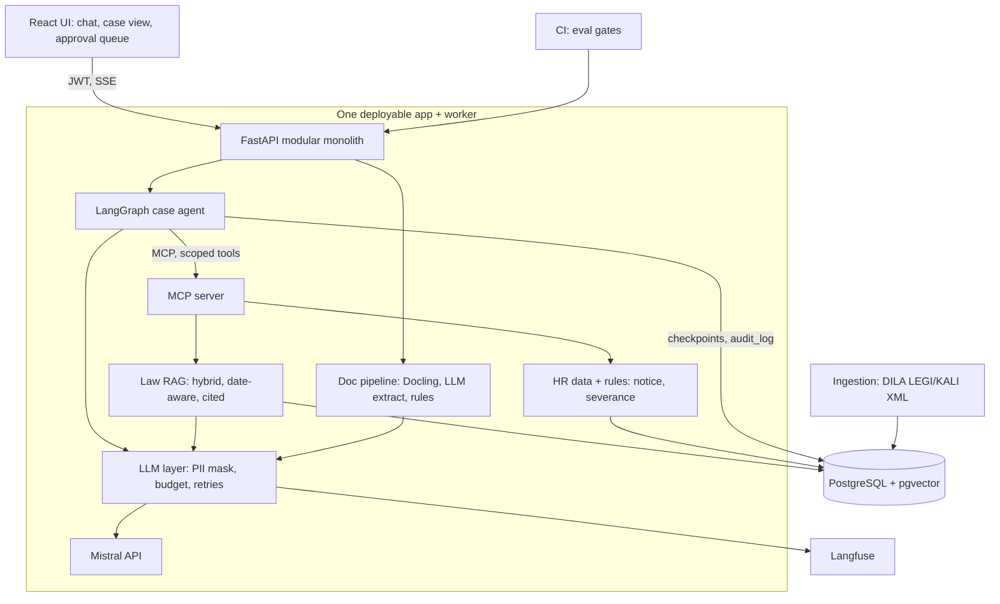

# LexRH: HR Case Copilot for French SMEs

> LexRH answers French labour-law questions with verifiable, date-aware citations. It can also run a whole HR case, such as a dismissal, through an agent that reads uploaded documents and calls business tools. It never acts without human approval, and it never sends personal data to the LLM.

  

**Live demo:** _<add URL>_ | **Demo video (3 min):** _<add link>_ | **Evaluation report:** [`EVALUATION.md`](./EVALUATION.md)

> **Disclaimer:** LexRH is decision support, not legal advice. All employee data in this repository is synthetic.

---

## Table of contents

1. [Problem](#problem)
2. [Features](#features)
3. [Architecture](#architecture)
4. [Tech stack](#tech-stack)
5. [Database design](#database-design)
6. [MCP tools](#mcp-tools)
7. [AI implementation](#ai-implementation)
8. [Security and engineering practices](#security-and-engineering-practices)
9. [Evaluation](#evaluation)
10. [Getting started](#getting-started)
11. [Repository layout](#repository-layout)
12. [Roadmap](#roadmap)
13. [Data sources and resources](#data-sources-and-resources)
14. [Limitations](#limitations)

---

## Problem

SME HR managers, payroll staff and accounting firms answer recurring questions every day: notice periods, overtime, leave, trial periods, dismissal procedures. The correct answer depends on the Code du travail **and** the company's collective agreement (IDCC), and it must be correct **for a given date**, because both change over time. Errors create legal and financial risk.

**Target users**
- HR generalists in SMEs without in-house lawyers
- Payroll staff
- Accountants managing several client companies with different IDCCs

---

## Features

| Layer | Function |
|---|---|
| **1. Knowledge (RAG)** | Hybrid retrieval over the Code du travail and collective agreements, filtered by IDCC and an "as of" date, with verified citations and refusal when evidence is weak. |
| **2. Documents** | Upload a contract or payslip. Docling parses it, an LLM extracts fields into a schema, deterministic rules validate it, and a human corrects it in a review screen. |
| **3. Case agent** | A LangGraph agent handles a case (for example "terminate employee X"). It calls MCP tools and pauses for human approval before any action. |
| **4. Trust layer** | PII masking before every LLM call, per-tenant budgets, Langfuse tracing, audit log, CI evaluation gates. |

### MVP vs advanced

| MVP (deployed) | Advanced |
|---|---|
| Code du travail only | 3 to 5 collective agreements (KALI) |
| Date-aware hybrid retrieval, cited answers, refusal | Reranker, query rewriting, caching |
| Auth, golden set, CI evaluation report | Case agent with MCP and approval flow |
| Live URL | Document extraction and review screen, PII masking, budgets |

---

## Architecture



### Components

| Component | Responsibility |
|---|---|
| Ingestion worker | Downloads LEGI/KALI XML (or calls the Légifrance API on PISTE), parses articles with ID, status, validity dates and IDCC. Chunks per article, embeds, upserts. Nightly run, re-embeds only when the content hash changes. |
| Query service (FastAPI) | Auth, query rewrite, hybrid retrieval (pgvector + full-text, filtered by IDCC and date), rank fusion, optional rerank, structured generation, citation verifier, SSE streaming. |
| Document pipeline | Docling layout parsing and OCR, LLM extraction into a Pydantic schema with confidence and source location, deterministic rules, routing to review. |
| MCP server | Exposes typed, permission-scoped tools to the agent. |
| Case agent (LangGraph) | State machine: classify, gather, assess, compute, interrupt for approval, execute, close. Postgres checkpoints. Step limit. |
| LLM layer | One internal module: PII masking, budget check, timeouts, retries with backoff, provider interface (Mistral behind an OpenAI-compatible abstraction). |
| Frontend (React + TS) | Chat with citations and date picker, case view with trace, document review, approval queue. |
| Observability | Langfuse traces for retrieval, tools and LLM calls, with cost and latency. |

### Data flows

1. **Question:** UI → `/ask` (JWT) → rewrite → hybrid retrieval (IDCC + date filter) → fusion/rerank → masked prompt → structured answer → citation verifier (retry once, otherwise refuse) → SSE to UI → trace to Langfuse.
2. **Document:** upload → object stored → job queued → Docling → LLM extraction → rules → auto-accept or review queue → human corrects → employee/contract record updated.
3. **Case:** user opens a case → agent loop calls MCP tools → deterministic computation → **interrupt** → handler approves, edits or rejects → agent drafts the letter → audit log entry.

**Frontend/backend communication:** REST + JSON for CRUD, SSE for streaming answers and agent progress, JWT bearer tokens, one OpenAPI schema from which TypeScript types are generated.

---

## Tech stack

| Component | Choice |
|---|---|
| Language | Python 3.12, type hints, Ruff, MyPy |
| API | FastAPI + Pydantic v2 |
| Database | PostgreSQL + pgvector + full-text search |
| Migrations | SQLAlchemy 2 + Alembic |
| Agent | LangGraph |
| Tool protocol | MCP (official Python SDK) |
| LLM | Mistral API behind an OpenAI-compatible interface |
| Document parsing | Docling (local layout + OCR) |
| Observability | Langfuse (self-hosted) |
| Packaging / CI | Docker Compose, GitHub Actions |
| Tests | pytest, testcontainers, Hypothesis |
| Frontend | React + TypeScript (Streamlit for the MVP) |
| Reranker | Cross-encoder from Hugging Face |
| Storage | MinIO (or local volume) |
| Queue | Postgres job table |

**Deliberately excluded:** Redis, Kubernetes, Terraform, fine-tuning, LangChain/LlamaIndex, a separate vector database, multi-agent frameworks. They add explanation cost without adding to the system's purpose. See `docs/adr/` for the reasoning.

---

## Database design

| Table | Key columns |
|---|---|
| `tenants`, `users` | `users(id, tenant_id, email, password_hash, role)`, roles `admin`, `hr`, `viewer` |
| `company_profiles` | `id, tenant_id, idcc, name, headcount` |
| `documents` (legal corpus) | `id, source[LEGI\|KALI], legal_id, title, idcc, valid_from, valid_to, status, content_hash` |
| `chunks` | `id, document_id, ord, text, embedding vector, tsv tsvector, metadata jsonb`. HNSW on `embedding`, GIN on `tsv`, B-tree on `(idcc, valid_from, valid_to)` |
| `employees` | `id, tenant_id, name_enc, hire_date, contract_type, salary, idcc` (synthetic data only) |
| `uploads` | `id, tenant_id, storage_key, sha256, status, doc_type` |
| `extractions`, `field_values` | `payload jsonb, schema_version, cost_eur`; `field, value, confidence, page, bbox` |
| `rule_results`, `reviews` | rule name, pass/fail, reviewer corrections |
| `conversations`, `messages`, `citations`, `feedback` | `messages(latency_ms, cost_eur)`; `citations(message_id, chunk_id, rank)` |
| `cases` | `id, tenant_id, employee_id, type, status` |
| `agent_runs`, `approvals` | `graph_state jsonb`; `action, payload jsonb, decided_by, decision, decided_at` |
| `audit_log` | `actor, action, tool, args_hash, result_summary, ts`. Append-only (no UPDATE/DELETE grant to the app role) |
| `llm_usage`, `budgets` | tokens, cost, cache flag per call; monthly limit per tenant |
| `eval_runs`, `eval_results` | `git_sha, config jsonb`; per-question metrics |

---

## MCP tools

| Tool | Scope | Notes |
|---|---|---|
| `search_law(query, idcc, as_of)` | read | Calls the RAG module, returns cited articles |
| `get_employee(employee_id)` | read | Tenant-checked; PII masked in what the LLM sees |
| `get_contract_fields(employee_id)` | read | From validated extractions |
| `compute_notice_and_severance(employee_id, as_of)` | compute | **Deterministic code**, unit-tested, returns a breakdown |
| `draft_letter(case_id, template)` | draft | Creates a draft only |
| `request_missing_documents(case_id, list)` | draft | Creates a draft only |
| `escalate(case_id, reason)` | write | Hands over to a human |

The agent runs under a least-privilege identity: it can read and draft, but it cannot send or finalise anything without an approval token created by a human decision.

---

## AI implementation

### RAG
- **Chunking:** one article per chunk, with the hierarchy path (code, book, title, chapter) prepended to the embedded text.
- **Hybrid retrieval:** exact references such as "L1234-1" are caught by full-text search and missed by embeddings, so both are fused with reciprocal rank fusion.
- **Date awareness:** filter on `valid_from <= as_of < valid_to` and on IDCC.
- **Grounded generation:** Pydantic schema `{answer, citations, confidence}`. The verifier rejects any cited ID that was not retrieved. Retry once, then refuse.
- **Prompt injection:** retrieved text is delimited and treated as data.

### Document extraction
The LLM only reads messy layouts into a schema. Validation is deterministic: net + VAT = gross where relevant, date logic, SIREN check digit, salary versus collective-agreement minimum, duplicate detection. A document is auto-accepted only when all rules pass and critical fields exceed a confidence threshold tuned on the evaluation set.

### Case agent
An agent is justified because the steps depend on the case: contract type, seniority, collective agreement and missing documents. The money decision stays in deterministic code. The LLM proposes, the human decides.
- Tool calling with strict JSON schemas and small, focused tools
- Context engineering: summarised tool results, cited clauses
- Step limit, per-tool timeouts, idempotency keys on side-effecting tools

### PII masking
Regex for email, phone, IBAN and NIR; NER model for names. Values are replaced with stable placeholders before the LLM call and restored after. Clear-text PII is never logged.

### Where not to use an LLM or agent
FAQ answering is a fixed pipeline, calculations are code, and validation is rules.

---

## Security and engineering practices

| Topic | Implementation |
|---|---|
| **AuthN/AuthZ** | OAuth2 password flow with short-lived JWT + refresh. Roles `admin`, `hr`, `viewer`. Every query filtered by `tenant_id` through FastAPI dependencies. The agent uses a separate service identity with scoped tools. |
| **Data protection** | Secrets in env/Docker secrets. Per-user rate limits. Input length limits. CORS allow-list. Signed, time-limited document URLs. Encrypted employee name column. Synthetic data only. 30-day log retention (GDPR). |
| **Prompt-injection defence** | Delimit untrusted text, validate tool arguments against the domain (the employee must belong to the tenant), allow-list recipients, maintain a test suite of attack cases. |
| **Error handling** | One error envelope with typed exceptions. Backoff with jitter on LLM 429/5xx. Per-stage timeouts. "Sources only" fallback when the LLM is down. Quarantine and reprocessing for failed documents. |
| **Logging / monitoring** | JSON logs with request IDs. Langfuse traces. `/health` and `/ready`. p50/p95 latency and cost per answer tracked. |
| **Testing** | Unit tests (parser, chunker, fusion, verifier, rules, masking). Integration tests with real Postgres via testcontainers. API contract tests. Mocked LLM in unit tests. Scripted fake LLM for graph tests. Separate evaluation job. |
| **Deployment** | Multi-stage non-root Dockerfile. Compose services: `api`, `worker`, `mcp`, `ui`, `postgres`, `langfuse`. Small European VPS behind Caddy or Nginx with TLS. |
| **CI/CD** | lint → type-check → unit/integration tests → evaluation gate → build → push to GHCR → deploy on tag. The build **fails** if recall@5 or citation precision drops beyond a threshold. |
| **Performance** | HNSW index, embedding cache, answer cache keyed by (normalised question, IDCC, date), async I/O, checkpoint resume for agent runs, load test with Locust or k6. |

---

## Evaluation

Every reported number comes from a committed evaluation run. Full tables and failure analysis are in [`EVALUATION.md`](./EVALUATION.md).

| Layer | Metrics | Source of truth |
|---|---|---|
| Retrieval | recall@k, MRR | Golden article IDs written from real HR FAQs |
| Generation | Citation precision, faithfulness (LLM judge with rubric), refusal accuracy on unanswerable questions | Golden set + adversarial questions |
| Extraction | Field accuracy, straight-through rate, error rate vs. threshold curve | Synthetic ground truth |
| Agent | Routing accuracy, tool-call precision/recall, correct approval stops, steps and cost per run | 60+ scripted scenarios |
| Security | Injection block rate, PII recall | Attack and PII test matrices |
| System | p50/p95 latency, cost per answer | Load test + Langfuse |

### Results

| Metric | Value |
|---|---|
| recall@5 (N-question golden set) | _TBD_ |
| Citation precision | _TBD_ |
| Agent scenarios resolved correctly | _TBD_ |
| Injection block rate | _TBD_ |
| p95 latency | _TBD_ |
| Cost per answer | _TBD_ |

---

## Getting started

> Commands below are the intended interface; adjust to the final repo.

```bash
# 1. Clone and configure
git clone https://github.com/<you>/lexrh.git
cd lexrh
cp .env.example .env        # set MISTRAL_API_KEY, JWT_SECRET, DB credentials

# 2. Start the stack (api, worker, mcp, ui, postgres+pgvector, langfuse)
docker compose up --build

# 3. Run migrations and ingest the Code du travail
docker compose exec api alembic upgrade head
docker compose exec worker python -m apps.worker.ingest --source LEGI

# 4. Run tests and the evaluation suite
uv run pytest
uv run python -m eval.run --suite golden
```

Use only public or synthetic data with any hosted LLM API.

---

## Repository layout

```
lexrh/
  apps/api/            # FastAPI, routers, auth
  apps/worker/         # ingestion, document jobs
  apps/mcp_server/     # MCP tools
  packages/rag/        # parser, chunker, retrieval, verifier
  packages/agent/      # LangGraph graph, tools client
  packages/docs/       # Docling pipeline, rules
  packages/llm/        # provider interface, PII masking, budgets
  web/                 # React frontend
  eval/                # golden sets, scenario suites, runners
  docs/adr/            # architecture decision records
  docker-compose.yml
  .github/workflows/
```

---

## Roadmap

| Week | Milestone | Done when |
|---|---|---|
| 1 | Repo skeleton (uv, Ruff, MyPy, pre-commit), Docker Compose (API, Postgres+pgvector, Langfuse), parse Code du travail | `docker compose up` works, parser tests pass |
| 2 | Article chunking with validity metadata, embeddings, idempotent re-ingestion | Re-running ingestion changes nothing |
| 3 | Hybrid retrieval with RRF and IDCC/date filters. Golden set of 100+ questions | recall@5 measured and committed |
| 4 | Structured generation, citation verifier, refusal, SSE, JWT auth. **Deploy MVP over HTTPS** | Live URL, evaluation report |
| 5 | MCP server, HR data and deterministic notice/severance rules, LangGraph agent with approval interrupt | A case runs end to end on synthetic data |
| 6 | Handler UI (trace, approve/edit/reject), audit log, 60+ scenario suite, injection tests | Scenario metrics in CI |
| 7 | Docling extraction and review screen, PII masking, budgets, KALI for 3 to 5 agreements | Field accuracy and PII recall measured |
| 8 | Reranker, caching, load test, ADRs, evaluation report, demo video | Everything deployed and documented |

**Scope cut order if behind:** React review screen (fall back to Streamlit), then reranking, then semantic caching, then KALI beyond 1 to 2 agreements.
**Never cut:** the golden set, the CI gate, the approval flow, the tests.

---

## Data sources and resources

- **Légifrance open data:** free to reuse. Bulk XML (LEGI, KALI and others) at <https://echanges.dila.gouv.fr/OPENDATA/>. The Légifrance API on PISTE is free after registration, under Licence Ouverte 2.0. Docs: <https://www.legifrance.gouv.fr/contenu/pied-de-page/open-data-et-api>
- **Judilibre** (court decisions): optional extension, available through PISTE.
- **Mistral API:** check your own account limits page; use only public or synthetic data on the free tier.
- **Langfuse:** MIT, self-hostable. <https://github.com/langfuse/langfuse>
- **Docling:** MIT, IBM Research. <https://arxiv.org/pdf/2501.17887>
- **LiteLLM:** mature open-source LLM gateway; the first option to evaluate for a production gateway.
- **Synthetic HR data:** generated with Faker and Jinja templates, rendered to PDF with noisy "scanned" variants.

---

## Limitations

- Decision support only. Refusal behaviour is intentionally visible when evidence is weak.
- Employee data is synthetic; no real personal data is processed.
- PISTE quotas, hosting prices and third-party library versions and licences should be verified before deployment.
- Collective-agreement coverage is limited to the agreements ingested.

## License

MIT (add a `LICENSE` file).
