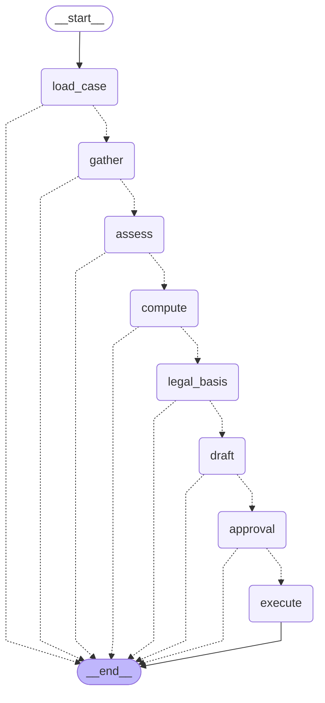

# Case agent (LangGraph + MCP)

`make agent CASE=case-001` runs a dismissal case on synthetic data and stops for a human decision
(`STDIO=1` calls the MCP server over stdio instead of in-process).

## What is code and what is a model

| Step | How |
|---|---|
| Routing, data checks, reference salary | Code |
| Notice and severance | MCP tools `compute_notice` / `compute_severance` (plain code, unit-tested) |
| Legal basis | MCP tool `search_law` (the only language-model step); fixed question, no personal data |
| Letter draft | Deterministic template |
| Approve / edit / reject | A human, through LangGraph `interrupt` |
| "Execute" | Records the approved letter as final. Sends nothing |

## Safety properties (all tested)

- Step limit: the agent escalates instead of looping.
- Escalation, not guessing: unknown case, unsupported type, missing pay data.
- If `search_law` fails the case continues with "sources unavailable".
- Audit log: one entry per step and tool call, arguments stored as hashes only, entries chained
  by hash so an edit or deletion is detected (`verify()`).
- Idempotent execution: same case and same letter is recorded once.
- No personal data in the law query (test checks every synthetic name).

## Not done yet

Checkpoints are in memory (a restart loses a paused case); the PostgreSQL checkpointer and an
audit table with no UPDATE/DELETE grant are the production versions of the same interfaces.
There is no approval screen yet (the CLI asks in the terminal).
